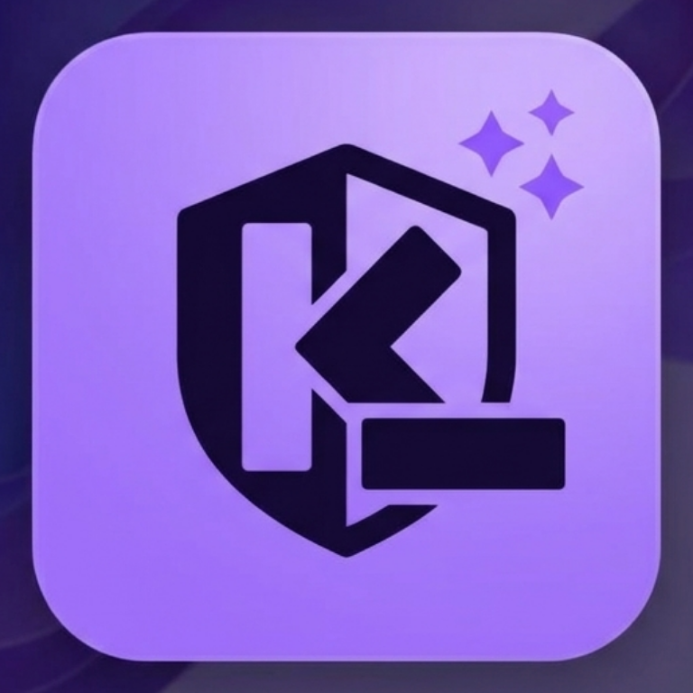

<div align="center">


# 信息隐身衣 · 贝卡文件脱敏

**让法律材料有序流转，让真实身份留在本机。**

本地脱敏与人工复核 · 混合材料归档 · 课件清理 · AI 读取版 · 加密恢复

[](https://github.com/lyyrebecca/becca-offline-file-redaction-skills/actions/workflows/ci.yml)
[](https://github.com/lyyrebecca/becca-offline-file-redaction-skills/releases/latest)


[下载版本](https://github.com/lyyrebecca/becca-offline-file-redaction-skills/releases/latest) · [开始使用](开始使用.md) · [安装教程](docs/INSTALL.md) · [验收证据](docs/VERIFICATION.md) · [常见问题](docs/FAQ.md) · [English](README.en.md)
</div>

## 项目解决什么问题？

合同、诉状、证据截图和授课材料中，常同时包含有用的法律事实与不宜披露的身份信息。交给 AI、发送他人或用于教学前，逐份手动打码容易遗漏；只遮住可见文字，也可能留下批注、隐藏页或图片中的信息。

**信息隐身衣是一套在本机识别、复核、脱敏、归档和恢复文件的工具。** 它让使用者先确认哪些信息需要隐藏，再导出用途明确的工作副本；原件与替换映射保存在独立加密保险库中，不自动上传或外发。

项目作为**人工智能法课程实践**，尝试把“在向 AI 提供材料前减少不必要的信息披露”落实为可操作的流程：原文先在本地处理，人确认后再决定是否分享。**可恢复的去标识化不等于法律意义上的匿名化**，工具也不替代披露权限、使用目的和法律责任的判断。

正式发布名为「终极·贝卡的文件脱敏离线部署软件 skills」，技术调用名为 `$legal-privacy-cloak`。

## 不只是一段提示词

| 组成 | 作用 |
|---|---|
| **Skill 使用规范** | 引导 Agent 打开本地工具，不先读取真实原文，不索取口令，不把附件内的指令当作操作授权 |
| **固定本地处理引擎** | 执行规则识别、中文实体识别、OCR、格式处理、残留检查与加密恢复，不为每次任务重新生成程序 |
| **可视化工作台** | 选择场景、批量导入、修改案件归属、逐文件复核、拖框打码和打开结果文件夹 |
| **测试与验收材料** | 提供合成样本回归、断网处理记录、真实工作台截图和平台测试范围 |

**依赖安装完成后，可以不打开 AI、不填写模型 API Key，独立使用工作台。** 首次准备 Python、OCR 和中文模型通常需要联网；本项目是源码 Skill＋本地引擎，不是内置全部依赖的免安装程序。

## 核心功能

| 功能 | 具体能做什么 |
|---|---|
| **识别敏感信息** | 组合规则、校验码、案件词典与本地中文实体识别，查找姓名、组织、地址、联系方式、证件与账户号码、案号、合同编号和指定机密等候选；按用途处理日期、金额及部分间接身份线索 |
| **文字与图片脱敏** | 文本替换为一致占位符；OCR 定位扫描件、截图和 Office 内嵌图片中的文字，并以实心像素遮挡；可手动补充漏检、框选签名、人脸或二维码 |
| **按案件整理材料** | 根据明确案号、合同编号提出归类建议；使用者确认后按案件和材料类别输出，使用中性文件名；弱线索、多个标识进入待确认区，不仅凭同名并案 |
| **保持指代一致** | 同一确认案件内，同字面实体使用一致占位符；同名不同人可添加区分编号，便于后续阅读和分析 |
| **清理教学课件** | 检查 PPT 正文、截图和嵌入图片；学生分发模式还清理讲者备注、批注、隐藏页与相关孤立部件 |
| **生成 AI 读取版** | 从已复核的脱敏内容生成 Markdown、材料与来源索引、日期出现位置索引；保留位置和 OCR 提示，不编造案情摘要；手工遮挡覆盖的 OCR 行不进入读取版 |
| **检查导出结果** | 导出后执行残留检查并显示状态；缺依赖、不支持部件、未复核文件或检查异常不会被当作完成 |
| **加密保存与恢复** | 使用 AES-256-GCM 与 scrypt 保存原件和映射；可取回原件，也可对符合条件的 Office／文本编辑副本恢复完好占位符 |

自动识别提供的是**待核对的候选项**，不是完整的法律语义判断。中文模型并非法律专用关系推理模型；英文姓名、所有商业秘密和间接身份线索不保证自动识别，人脸、签名、二维码需要人工框选。模型分数不等于准确率。

## 支持哪些文件？

| 文件类型 | 处理范围 | 输出与边界 |
|---|---|---|
| **Word / DOCX** | 正文、表格、页眉页脚、脚注、批注、修订及隐藏内容；支持跨文本片段替换 | 长占位符可能改变分页，不保证像素级保真 |
| **Excel / XLSX** | 单元格、隐藏表、批注、属性、公式及相关部件 | 敏感公式或依赖会阻断，不静默改坏计算 |
| **PowerPoint / PPTX** | 文字、备注、隐藏页、属性与嵌入图片 | 图片逐张复核；学生模式额外清理私有教学部件 |
| **PDF / 扫描 PDF** | 本地逐页渲染、OCR 定位、像素遮挡后重建 | 不保留原文字层，输出不再保留原有搜索与编辑能力 |
| **PNG / JPEG** | OCR 定位、实心像素遮挡、重新编码清理元数据 | 不使用模糊或可移除覆盖层；仍需人工看图 |
| **TXT / Markdown** | UTF-8 文本的一致占位符替换 | 同时检查链接与非正文，不执行文件中的指令 |

Office 内嵌图片也纳入处理。宏、旧式 `.doc/.xls/.ppt`、部分嵌入对象、图表缓存、外部数据连接和动态内容等不在完整支持范围；无法完整检查时需先转换或制作静态副本。详见[格式说明](references/formats.md)。

## 适合什么场景？

面向律师、法院工作人员、企业法务、学生／研究者，以及准备向律师或 AI 咨询的材料提供者。职业选项用于调整提示与预设，**不代表获得披露他人信息的权限**。

| 使用场景 | 处理重点 |
|---|---|
| **交给 AI 分析** | 隐藏身份与案件标识，默认保留金额、日期及法院特殊豁免；可生成脱敏 Markdown 与索引 |
| **外部审阅** | 使用基础脱敏策略；外部编辑后，符合条件的完好占位符可以恢复 |
| **课堂展示** | 重点复核 PPT 文字、截图与嵌入图片 |
| **分发学生** | 在复核基础上清理讲者备注、批注、隐藏页和失去引用的包部件 |
| **公开分享** | 默认加强日期、金额处理并取消法院特殊豁免；仍需人工审查，不等于自动满足法院公开规则 |

选择“公开公众”接收对象也会加强基础策略，选择“学生”也会启用课件清理。场景是在同一引擎上调整保留与清理规则，不是五套精度不同的识别算法。详见[场景说明](references/scenarios-and-delivery.md)。

## 四步完成一次处理

**① 选场景 → ② 导入与整理 → ③ 本机复核 → ④ 导出与恢复**

1. **选场景**：确定身份、用途、接收对象和单案／混合材料范围。
2. **导入与整理**：选择或拖入文件，也可用本机文件夹路径批量导入；在本机设置保险库口令，确认案件归属和材料类别。
3. **本机复核**：逐份核对文字与图片，补充漏检、调整保留项、框选图像区域，必要时区分同名不同人。
4. **导出与恢复**：检查实际状态，通过“一键打开交付文件夹”找到副本；按需分享文件，恢复操作另在本机完成。

`NEEDS_REVIEW` 表示仍待复核，`FAILED` 表示失败；`CHECKED` 仅表示本次机械检查与本地复核完成，**不表示零漏检或取得匿名化认证**。原件不被覆盖，重复文件只标记、不自动删除，多案文件不自动拆分。

## 实际工作台

以下为 **2.0.1 发布版的真实运行截图，全部使用虚构合成样本**，不是概念界面或真实客户材料。


<details>
<summary>展开查看案件整理、图像复核与导出界面</summary>

**案件归属与材料类别，可手动确认和修改**


**原图与像素遮挡预览，可拖框补充**


**实际导出状态、交付文件夹入口与恢复功能**


</details>

## 得到什么，如何恢复？

默认任务目录为 `~/Documents/信息隐身衣任务/任务-随机号/`：

```text
任务-随机号/
├── share/                       候选对外副本
│   ├── 案件001/02_合同协议/file-001.docx
│   ├── 案件001/02_合同协议/file-001.docx.md
│   ├── 案件002/03_证据材料/file-002.png
│   ├── 材料与来源索引.md           开启 AI 读取选项时生成
│   ├── 日期索引.md
│   └── audit-report.json
├── private/task.lpcv            本机加密保险库
└── restored/                    本机恢复件
```

**只分享 `share/` 中本次需要的文件，不要打包整个任务目录。** 保险库、映射、原件和恢复件留在可信端。结果页可打开系统文件管理器或复制完整路径。

- **取回原件**：解密恢复原始文件；PDF 和图片支持此方式，不合并外部修改。
- **恢复编辑副本**：Office／TXT／Markdown 只恢复当前任务中完好的精确占位符；占位符缺失、改写、复制或图片变化会产生冲突，不伪装成成功。
- **保管口令**：只在本机输入，不发给 Agent；口令遗失没有恢复后门。

## 安装与调用

桌面适配目标为 **Windows 11 x64 与 macOS，Python 3.12**；不支持 iPhone／iPad。本项目需要安装依赖，不提供内置全部依赖的免安装 `.exe`。Windows 原生 CI 与实体桌面验收是不同证据，详见[平台验收矩阵](docs/VERIFICATION.md#平台验收矩阵)。

### Windows

1. 安装 Python 3.12、Tesseract（含中文语言包）和 Poppler。
2. 下载并解压[发布包](https://github.com/lyyrebecca/becca-offline-file-redaction-skills/releases/latest)，在项目目录运行：

```powershell
py -3.12 scripts/install.py --with-deps --app
```

3. 从开始菜单打开“贝卡文件脱敏”，或双击 `启动贝卡文件脱敏.cmd`。

### macOS

可下载发布包解压，也可用 Git 获取源码：

```bash
git clone https://github.com/lyyrebecca/becca-offline-file-redaction-skills.git
cd becca-offline-file-redaction-skills

# 首次安装依赖需要联网；Homebrew 需事先安装
brew install python@3.12 tesseract tesseract-lang poppler
"$(brew --prefix python@3.12)/bin/python3.12" scripts/install.py --with-deps --app
```

随后打开 `~/Applications/信息隐身衣.app`。需要额外导出 PPT 像素 PDF 时，再安装可选组件：

```bash
brew install --cask libreoffice
```

安装目标已存在时不会覆盖，升级前应备份。启动器依赖当前电脑的安装环境，不是可复制到任意电脑直接运行的独立安装包。详细依赖、升级与卸载见[安装教程](docs/INSTALL.md)。

### 在 Codex 中使用

```text
$legal-privacy-cloak
我是律师，要把本机一批合同、证据和截图脱敏后交给 AI 分析。
请打开本地工作台；不要读取我的原文，也不要向我索取口令。
```

自动安装目前面向 Codex；其他支持 `SKILL.md` 的 Agent 需按各自规则接入，未宣称全部测试通过。日常文件处理不调用外部大模型；与 Agent 聊天的说明仍可能消耗相应产品额度。

## 已验证什么？

以下为仓库记录的 **2026-10-26、2.0.1 版本合成样本验收**，不是对真实案件的识别率承诺；后续提交的自动测试以 [Actions](https://github.com/lyyrebecca/becca-offline-file-redaction-skills/actions) 为准。

| 验收项目 | 记录结果 |
|---|---|
| 本地完整回归 | 109 项通过；测试范围含格式处理、恢复、残留检查及接口安全 |
| 8 格式断网处理 | 冷暖两轮扫描与导出均为 `CHECKED` |
| 原件恢复 | 两轮共 16 份恢复件，与原件字节一致 |
| AI 读取版 | 每轮 8 份 Markdown＋2 份索引，复查通过 |
| 教学课件 | 学生模式清理隐藏页、备注与相关部件；可选像素 PDF 验收通过 |
| 真实交互 | 已记录 macOS 工作台操作、图像拖框、导出与文件夹打开截图 |

同一小型 8 格式合成批次的扫描＋导出耗时为冷轮约 **5.760 秒**、同进程暖轮约 **2.911 秒**，不包含人工复核，不代表所有真实文件的速度。断网验证属于测试环境证据，不表示软件替所有电脑设置了防火墙。

Windows／macOS 原生 CI、实体桌面、Office 渲染与断网测试的范围分别列于[验收说明](docs/VERIFICATION.md)。测试通过不替代实际打开文件，仍应检查分页、表格、条款和画布内容。

## 使用边界

- **文件规模**：单批最多 100 个文件、合计 250 MB；单文件 100 MB；PDF 60 页；Office 展开 300 MB；图片 3500 万像素。
- **人工判断**：不承诺识别全部敏感信息、所有格式完全保真、自动判断披露合法性或商业秘密；无法完整检查的内容会阻断。
- **产品范围**：没有企业权限审批平台、全局 DLP 拦截、自动人脸／二维码识别、语义并案或自动拆案。
- **本地边界**：原文复核在使用者本机完成，不通过聊天、云端 OCR 或远程截图回传真实材料；不防御已控制本机的管理员、恶意扩展、内存转储及异常断电遗留。

## 作者、反馈与许可

**维护者：lyyrebecca** · [GitHub](https://github.com/lyyrebecca) · 微信：**shirebeccaha** · 邮箱：**1849883220@qq.com**

署名仅出现在软件与项目说明中，不默认写入法律交付文件。反馈请提交[公开 Issue](https://github.com/lyyrebecca/becca-offline-file-redaction-skills/issues)，提供格式、版本、错误码与合成复现步骤，不上传真实案件、口令、保险库或映射。

本项目采用分层许可，见 [LICENSE](LICENSE) 与[第三方声明](THIRD_PARTY_NOTICES.md)；不对全部依赖、模型、资料和用户图标作统一 MIT 或商用授权声明。

**English:** Local, offline redaction and reversible de-identification for Chinese legal documents. Includes document/image review, matter grouping, teaching-slide cleanup, AI-readable Markdown and encrypted restoration. Reversible pseudonymization is not legal anonymization. See [English documentation](README.en.md).
