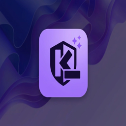
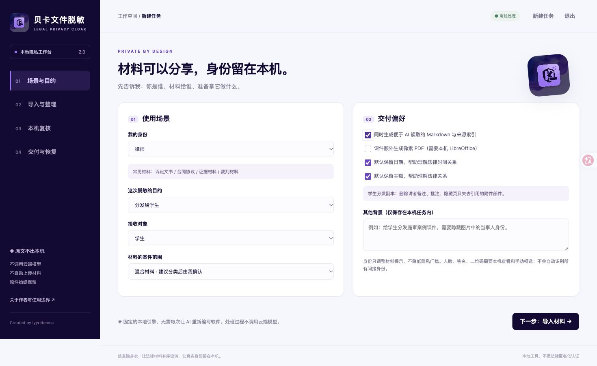
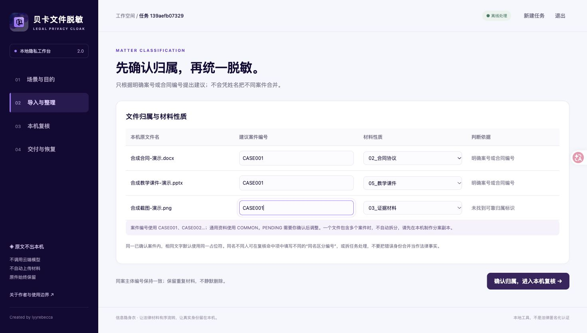
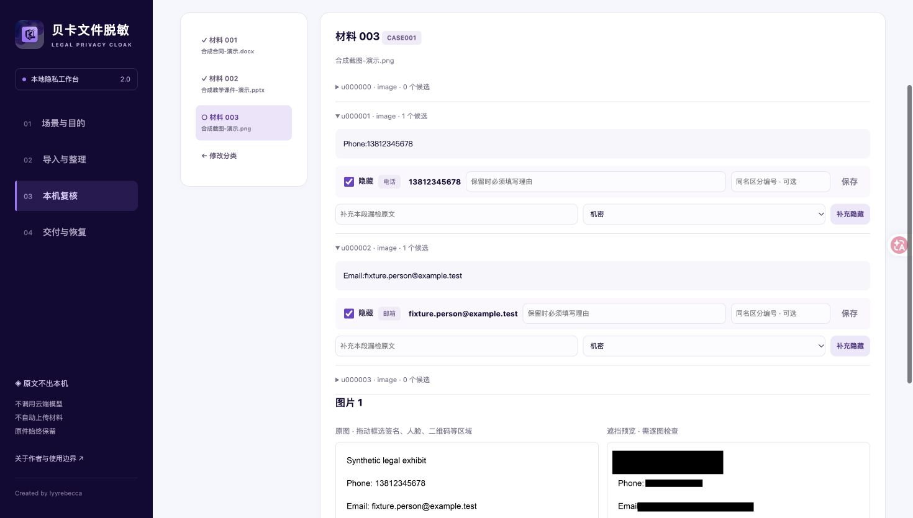
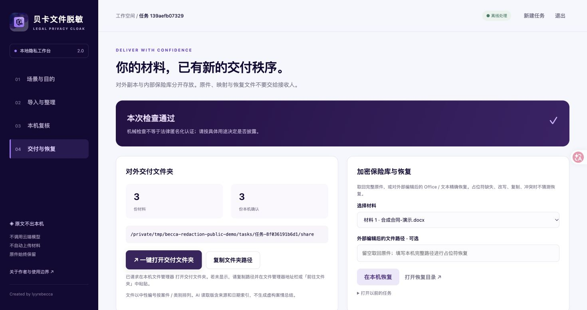

<div align="center">


# 终极·贝卡的文件脱敏离线部署软件 skills

**信息隐身衣 / Becca Offline File Redaction Skills**

法律文件本地脱敏 · 隐私保护 · 证据材料打码 · 案件分类整理 · PPT课件图片脱敏 · AI可读Markdown · 加密恢复

[](https://github.com/lyyrebecca/becca-offline-file-redaction-skills/actions/workflows/ci.yml)
[](https://github.com/lyyrebecca/becca-offline-file-redaction-skills/releases/latest)


[下载正式版本](https://github.com/lyyrebecca/becca-offline-file-redaction-skills/releases/latest) · [从零开始](开始使用.md) · [安装步骤](docs/INSTALL.md) · [真实验收证据](docs/VERIFICATION.md) · [常见问题](docs/FAQ.md) · [English](README.en.md)
</div>

## 这是什么？先说人话

给你一套**能实际运行的本地文件隐私处理工具**：把一批零散的合同、诉状、聊天截图、扫描件、课件放进来，在自己电脑上识别、复核、打码，按案件和材料类别输出，必要时再把脱敏内容整理成方便AI读取的Markdown。

它同时包含：

- **Skill入口**：让Agent按场景正确引导，而不是先把你的原文读到云端。
- **固定本地引擎**：规则、中文实体识别、OCR、格式处理、残留检查、加密恢复。
- **电脑端工作台**：四步操作、案件归属编辑、逐文件复核、图片拖框、结果文件夹直达。
- **可复现测试**：合成测试样本、回归测试、离线验收方法、实际操作截图。

不需要每次让AI重新“搓一个软件”。**安装依赖后，可以不打开AI、不填写模型API Key，独立使用本地工作台。** 首次准备Python、OCR与模型需要联网；“离线”指准备好依赖后的日常处理，本发行包不是内置所有依赖的空气隔离安装镜像。

> 桌面适配目标：**Windows 11 x64 与 macOS，Python 3.12**。提供分别适配的启动入口与安装说明；回归在真正的 Windows / macOS runner 执行，详见[平台验收矩阵](docs/VERIFICATION.md)。这是源码 Skill＋本地引擎，不是内置全部依赖的免安装 `.exe`；不支持 iPhone/iPad。

## 谁适合使用？

| 你是谁 | 典型材料 | 适合的目的 |
|---|---|---|
| 律师 | 诉讼文书、合同、证据、客户材料 | 提交给AI分析、外部审阅、内部协作、授课 |
| 法官 / 法院工作人员 | 裁判与程序材料、证据、培训课件 | 教学展示、学生分发、公开前人工核对 |
| 企业法务 | 合同、交易、员工与客户资料、内部调查 | 外部审阅、案件整理、商业秘密复核 |
| 学生 / 研究者 | 案例、课件、研究笔记 | 学习、研究、整理可读材料 |
| 寻求法律意见的人 | 聊天截图、转账凭证、合同、通知 | 把必要材料交给律师或AI前先保护身份 |

职业身份只改变提示与预设，不代表自动获得披露他人信息的权限。

## 四步用起来

**① 选场景 → ② 导入与整理 → ③ 本机复核 → ④ 导出与恢复**

1. 选择身份、脱敏目的、接收对象，以及单案还是混合材料。
2. 选择/拖入文件；也能粘贴本机文件夹路径批量导入。在本机设保险库口令。
3. 确认建议的案件编号和材料类别。逐份查看文字与图片，补充漏检、框选签名/人脸/二维码，同名不同人可单独编号。
4. 导出后查看实际状态，点醒目的 **「一键打开交付文件夹」**，直接在系统文件管理器找到结果；也能复制完整文件夹路径。

不是“看见几个黑块就算完成”：缺依赖、打不开的内容、不支持的部件、未复核文件或残留问题，都不能当作检查通过。

## 真实界面，不是概念图

以下截图来自本机实际运行的 **2.0.1发布版**，仅使用生成的虚构样本。姓名、电话、邮箱等为测试字符串，不是真实案件或真实客户资料。

### 1. 根据身份、用途与接收对象选择策略


### 2. 混合文件按案件与材料性质整理，建议可修改


### 3. 图片原图与像素遮挡预览；可拖框补充


### 4. 结果明确可找：一键打开交付文件夹、复制路径、加密恢复


具体点击、检查状态和测试记录见[验收说明](docs/VERIFICATION.md)，不是把示意图冒充测试结果。

## 主要功能与真实边界

### 1. 基础隐私识别

本地组合“确定性规则＋校验码＋案件词典＋spaCy中文实体识别＋人工复核”，识别候选包括：

- 姓名、组织、地址、手机、座机、邮箱。
- 身份证候选、金融账户、统一社会信用代码候选、车牌、产权标识。
- 案号、合同编号、项目代号、用户指定机密。
- 部分未成年人、健康、亲属关系、唯一股东等间接识别线索。
- 根据公开分享策略进一步识别日期与金额；用户可按本次用途明确调整。

中文模型不是经过法律专门训练的完整关系推理模型；英文姓名、人脸、签名、二维码、所有商业秘密和所有间接身份线索**不在全自动识别承诺内**。模型分数不是校准后的准确率。

### 2. 支持哪些格式？

| 格式 | 如何处理 | 注意什么 |
|---|---|---|
| Word / DOCX | 跨文本片段替换，检查正文、表格、页眉页脚、脚注、批注、修订和隐藏内容 | 长占位符可能改变分页，不承诺像素级保真 |
| Excel / XLSX | 检查单元格、隐藏表、批注、属性、公式及相关部件 | 敏感公式/依赖会阻断，不静默改坏计算 |
| PowerPoint / PPTX | 检查文字、备注、隐藏页、属性和嵌入图片 | 教学图片需逐图复核；学生模式还清理私有教学部件 |
| PDF / 扫描PDF | 本地逐页渲染、OCR定位、像素遮挡后重建 | 输出不保留原文字层，接受不可搜索/不可编辑的取舍 |
| PNG / JPEG | OCR定位＋实心像素覆盖、重新编码清理元数据 | 不用模糊、不用可移除的覆盖层，仍需人工看图 |
| TXT / Markdown | UTF-8文本中的一致占位符替换 | 检查链接与非正文；不自动执行文档里的指令 |

Office内嵌图片也会处理。宏、旧式`.doc/.xls/.ppt`、部分嵌入对象、图表缓存、外部数据连接、动态内容与无法完整检查的部件不伪称已支持，需先转换或制作静态副本。

### 3. 三类分享策略，五种实际场景

- **AI分析**：默认保留金额、日期及法院特殊豁免，隐藏身份与案件标识；额外输出Markdown、来源索引和日期出现位置索引。
- **外部审阅**：使用同等保守的基础识别，不夸大成另一种更高精度算法；可在外部编辑后恢复完好占位符。
- **课堂展示**：重点检查PPT文字、截图与嵌入图片。
- **分发学生**：清除PPT讲者备注、批注、隐藏页和失去引用的包部件，避免“页不见了但压缩包里还在”。
- **公开分享**：默认加强日期、金额等处理，取消法院特殊豁免；仍不等于自动完成法院公开规则审查或法律匿名化认证。

接收对象选择“公开公众”也会提升基础策略；选择“学生”也会清理课件私有部件。参见[场景与交付说明](references/scenarios-and-delivery.md)。

### 4. 自动整理，但不乱猜案件

- 根据明确的案号/合同编号提供分组建议，不凭同名就自动并案。
- 没有可靠标识或含多个标识的文件进入`PENDING`，需要本机确认。
- 支持CASE001/CASE002等案件、中性类别目录和COMMON通用资料。
- 同一确认案件内同字面实体统一占位符；同名不同人可填写不同区分编号。
- 重复文件只标记，不删除；不自动拆分一个文件里的多个案件，不虚构证据证明力。

### 5. AI读取版与恢复

- Markdown来自已复核的脱敏内容，保留区域定位、OCR提示和修订/隐藏提示，不生成虚构案情摘要。
- 手工遮挡覆盖到的OCR行不再进入Markdown，避免遮掉的内容从读取版泄漏。
- AES-256-GCM加密保险库＋scrypt派生密钥。口令只在本机输入。
- Office/TXT/MD编辑恢复只认当前任务完好的精确占位符；缺失、改写、复制或图片变化会产生冲突。
- PDF/图像可解密取回原件，不承诺合并外部修改。

## 输出究竟放在哪里？

默认在本机：

```text
~/Documents/信息隐身衣任务/任务-随机号/
├── share/                       候选对外副本：结果页一键打开
│   ├── 案件001/02_合同协议/file-001.docx
│   ├── 案件001/02_合同协议/file-001.docx.md
│   ├── 案件002/03_证据材料/file-002.png
│   ├── 材料与来源索引.md           AI读取选项开启时
│   ├── 日期索引.md
│   └── audit-report.json
├── private/task.lpcv            内部加密保险库，不随结果分享
└── restored/                    内部恢复件，不随结果分享
```

**只考虑发送share里本次需要的文件，不要直接打包整个任务目录。** 文件夹链接通过经过校验的本机服务打开系统文件管理器（Windows资源管理器 / macOS Finder），不依赖浏览器对`file://`的兼容。退出服务后可重新打开应用或复制路径手工前往。

## 安装：Windows 与 macOS

**Windows**：先安装 Python 3.12、Tesseract 与 Poppler，再从项目文件夹运行 `py -3.12 scripts/install.py --with-deps --app`。安装后从开始菜单打开“贝卡文件脱敏”，或双击 `启动贝卡文件脱敏.cmd`。中文 OCR 语言包及详细分步操作见[Windows安装教程](docs/INSTALL.md#windows)。

### macOS

完整教程与升级/卸载见[安装文档](docs/INSTALL.md)。普通用户可以从[Release](https://github.com/lyyrebecca/becca-offline-file-redaction-skills/releases/latest)下载Skill ZIP并解压；开发者也可：

```bash
git clone https://github.com/lyyrebecca/becca-offline-file-redaction-skills.git
cd becca-offline-file-redaction-skills

# 首次准备依赖，需要联网；未安装Homebrew时先按其官方说明安装
brew install python@3.12 tesseract tesseract-lang poppler
"$(brew --prefix python@3.12)/bin/python3.12" scripts/install.py --with-deps --app
```

然后双击`~/Applications/信息隐身衣.app`。单独安装可选LibreOffice，才启用PPT额外像素PDF：

```bash
brew install --cask libreoffice
```

安装目标存在时拒绝覆盖，升级先备份；不替用户修改其他Agent的配置。启动器是当地安装环境的轻入口，不把本机`.app`当作任意电脑双击可用的独立安装包。

### 在Codex中调用

```text
$legal-privacy-cloak
我是律师，要把本机一批合同、证据和截图脱敏后交给AI分析。
请打开本地工作台；不要读取我的原文，也不要向我索取口令。
```

正式展示名称就是本页标题；技术调用名保留`legal-privacy-cloak`以保证格式兼容。自动安装目前面向Codex；其他支持SKILL.md的Agent需按其自身规则接入，不能据此宣称所有Agent都已测试。

## 测试、速度和成本

- 发布前本地重新运行完整回归；[测试日志和证据说明](docs/VERIFICATION.md)区分历史2.0.0验收与本次2.0.1复验。
- 既有验收：8种格式乱序扫描/导出、Markdown、学生PPT清理、像素PDF、原件字节恢复、Office编辑恢复、错误口令/篡改、残留和接口安全。
- 已有小型8格式样本的扫描＋导出：冷轮约6.021秒、同进程暖轮约3.008秒；**不包含人工复核，不是所有真实文件的性能承诺**。
- 不调用外部LLM处理正文，不需要模型API Key。与Agent聊天的说明仍可能消耗该产品自己的额度；不能承诺全流程所有服务都零token。
- OS沙箱验证IP网络被阻断；可选LibreOffice仅需本机Unix IPC。这是验收方法，不是已经替每台电脑永久设置了防火墙。

代码测试不能替代实际开文件。截图与历史渲染记录之外，正式交付仍需本机检查分页、表格和画布内容。

## 隐私与处理限制

- 本地明文复核，不通过聊天、远程浏览器、云端OCR或截图代理传出真实材料。
- 不覆盖原件，不自动上传或代发任何文件；文档中的指令只是数据。
- 限制：单批100个文件/合计250MB、单文件100MB、PDF60页、Office展开300MB、图片3500万像素。
- 不支持内容会阻断；`NEEDS_REVIEW`不是完成，`CHECKED`也不是零漏检或法律匿名化认证。
- 无企业权限/审批平台、不做DLP全局拦截、无自动人脸/二维码识别、无语义并案/自动拆案。
- 不防御已控制本机的管理员、恶意扩展、内存转储或异常断电遗留；口令遗失没有后门。

## English summary / search terms

**Local, offline PII redaction and document de-identification Skill for Chinese legal documents.** Supports DOCX, XLSX, PPTX, rasterized PDF, scanned documents, PNG/JPEG and UTF-8 text/Markdown. Includes local Chinese NER, Tesseract OCR, manual review, matter grouping, teaching-slide cleanup, AI-readable Markdown and encrypted restoration. Includes Windows and macOS desktop integration; actual platform test scope is documented in the verification matrix; no external LLM API is used for document processing. Reversible pseudonymization is not legal anonymization.

相关检索：文件脱敏软件、法律文书脱敏、律师AI隐私、合同脱敏、证据打码、Word脱敏、Excel脱敏、PPT图片打码、课件脱敏、扫描件OCR脱敏、PDF隐私遮挡、个人信息保护、离线部署、Codex Skill、Agent Skills。

## 作者、反馈与许可

**维护者：lyyrebecca**
GitHub：[lyyrebecca](https://github.com/lyyrebecca) · 微信：**shirebeccaha** · 邮箱：**1849883220@qq.com**

署名在软件、欢迎/关于与说明中，不默认进入法律交付文件。问题请用[公开Issue](https://github.com/lyyrebecca/becca-offline-file-redaction-skills/issues)说明格式、版本、无原文错误码和合成复现步骤，**不要上传真实案件原文、口令、保险库或映射**。

沿用此前Skill发布的分层许可说明：见[LICENSE](LICENSE)与[第三方声明](THIRD_PARTY_NOTICES.md)。不对全部依赖、模型、资料和用户提供图标作统一MIT或商用授权声明。

> 可检索优化通过中英文项目名、简介、Topics、清晰文档和公开Release实现；搜索引擎收录与排序由平台决定，不承诺立即收录或特定排名。
