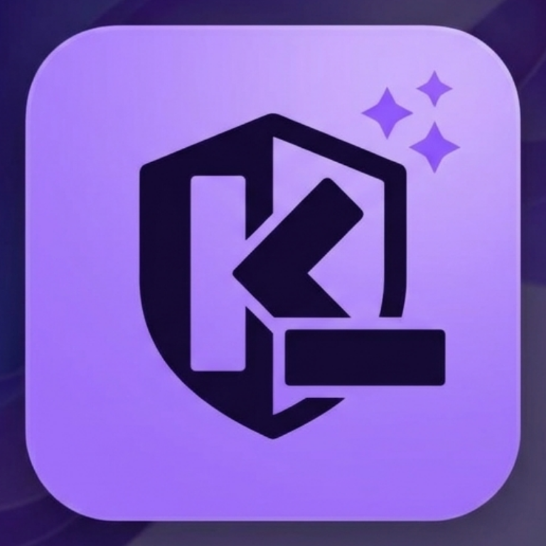
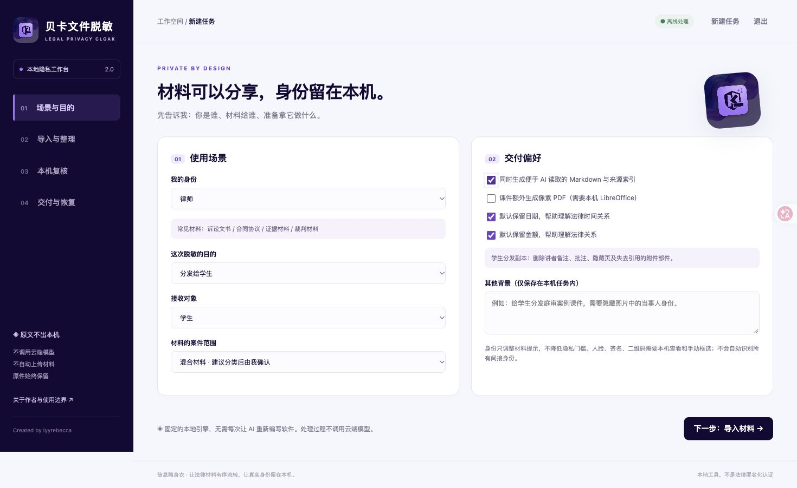

<div align="center">


# 信息隐身衣 · 贝卡文件脱敏

**让法律材料有序流转，让真实身份留在本机。**

**v2.4.2 · Windows / macOS · 制作者：李玥滢（lyyrebecca）**

[](https://github.com/lyyrebecca/becca-offline-file-redaction-skills/actions/workflows/ci.yml)
[](https://github.com/lyyrebecca/becca-offline-file-redaction-skills/releases/latest)


[下载最新版](https://github.com/lyyrebecca/becca-offline-file-redaction-skills/releases/latest) · [开始使用](开始使用.md) · [安装教程](docs/INSTALL.md) · [验收范围](docs/VERIFICATION.md) · [常见问题](docs/FAQ.md) · [English](README.en.md)
</div>

## 这是什么？

一套面向法律材料的 **Skill＋固定本地处理引擎＋可视化工作台**。识别候选、由人在本机复核，再导出去标识化工作副本；原件和替换映射保存在独立加密保险库中，不自动上传或外发。

项目用于人工智能法课程实践，**由李玥滢个人制作**。课程提交形式不代表项目由多人共同开发。技术调用名保留为 `$legal-privacy-cloak`，仓库沿用原名以兼容既有链接。

依赖准备完成后，不打开 AI、不填写模型 API Key，也能独立使用。首次准备 Python、中文模型与 OCR 通常需要联网；发行包不内置全部运行时，不是免安装 `.exe`。

## 本次更新了什么？

相较仓库此前的 2.0.1 发布版，2.4.2 源码带来以下变化（不为中间版本推定发布日期）：

| 新功能 | 使用方式与边界 |
|---|---|
| **拖选补漏、批次映射** | 拖选漏检文字、选择类别，将精确同字面项应用到本批文本/OCR；改动后相关文件需要重新复核，不做语义泛化 |
| **取消单条候选** | 右键候选并二次确认，可取消该条遮盖；需要结合上下文判断，不能据此解除结构性阻断 |
| **数字／编码候选** | 可见文本与 OCR 中额外列出连续数字或字母数字编码；默认不打码，由用户选择，不把内部结构锚点混入这类候选 |
| **本机加密学习库** | 可记住用户明确新增的精确词条，未来任务使用同一口令才载入；不是自动训练模型，也不推断跨案件身份 |
| **图片位置编号** | 自动遮挡位置可跳转对应候选；手工框有编号，可以移除并重画 |
| **更多文本格式** | 增加 CSV/TSV、JSON/XML/LOG 与受限纯文本 EML；编码、动态内容及邮件结构有明确限制 |
| **简化案件流程** | 工作台每批默认同一案件，无需逐文件填案件编号或分类；多案分开新建任务，仍需逐份复核 |
| **跨平台安装** | Windows/macOS 共用引擎，版本隔离环境、工具路径探测、中文控制台、Windows 启动器与可选快捷方式 |
| **2.4.2：阻断提示可解释** | 交付页逐材料列出阻断原因、错误码和处理说明，可返回相应复核页；存在阻断时主按钮返回材料，不提交必然失败的导出 |

2.4.2 不降低导出门槛：软性人工确认不能覆盖结构性阻断；未知问题也按失败关闭处理。新增提示不等于修复或支持原本不支持的文件结构。

## 核心能力

- **本地识别**：规则、案件词典、中文实体模型和 OCR 提供姓名、组织、地址、联系方式、证件／账户、案号、合同编号等候选；访问凭证、内部路径、表格列语境也纳入相应规则。
- **逐份复核**：文本预览、图片与扫描件 OCR、人工补漏、保留理由、拖框遮挡；人脸、签名、二维码仍需人工看图。
- **按用途处理**：AI 分析、外部审阅、课堂展示、分发学生、公开分享；职业选项不是披露授权。学生模式额外清理 PPT 备注、批注、隐藏页及相关孤立部件。
- **导出与检查**：一致映射、可选 AI 读取版 Markdown 与索引、导出后残留验证；不能完整检查的结构不当作成功。
- **加密与恢复**：AES-256-GCM＋scrypt 保存原件与映射；可按字节取回原件，对满足条件的编辑副本恢复完好占位符。

## 支持哪些文件？

| 类型 | 范围与边界 |
|---|---|
| DOCX / XLSX / PPTX | Office 文字、相关元数据及支持的嵌入图片；显示 `***`，恢复依赖原文本单元与偏移等条件。敏感公式、复杂嵌入或动态部件可能阻断，不保证原分页完全不变 |
| PDF / 扫描 PDF | 本地逐页渲染、OCR、像素遮挡后重建；不保留原文字层和原有可编辑能力 |
| PNG / JPEG | OCR＋实心像素遮挡＋重新编码；不使用可移除覆盖层或模糊 |
| TXT / Markdown | UTF-8（可带 BOM），一致内部占位符；链接与非正文同样需要检查 |
| CSV / TSV | UTF-8 分隔文本；按支持的字段／文本规则处理，结构限制见格式说明 |
| JSON / XML / LOG | UTF-8；按实际解析范围处理。XML DTD 等不安全结构阻断，不执行内容 |
| EML（受限） | 仅单段 `text/plain`，可解码 MIME Base64/quoted-printable；多段、HTML、附件阻断。输出是不可直接发送的 `X-LPC-*` 复核副本 |

未知格式、宏、旧式 `.doc/.xls/.ppt` 及未支持结构不在完整支持范围。OCR/PDF 缺少本地工具或语言数据时停止相应处理，不回退云端。详见[格式边界](references/formats.md)。

## 四步使用

**场景与目的 → 导入材料 → 本机复核 → 交付与恢复**

1. 选身份、用途和接收对象；默认用于 AI 分析。
2. 导入同一案件的文件，在本机设定至少 12 字符的保险库口令；多个案件分别建任务。
3. 逐份查看文字、候选与图片，补漏、决定保留项、确认本批修改影响；不把真实原文或口令发给 Agent。
4. 交付页先检查阻断清单；无阻断且复核完成后导出。结果页可一键打开系统文件管理器或复制完整路径。

`NEEDS_REVIEW` 是未完成，`FAILED` 是失败；`CHECKED` 只表示本次机械检查和本地复核通过，不等于零漏检或法律匿名化认证。

仅将 `share/` 中本次需要的文件作为候选交付件；不要打包整个任务目录。`private/`、`restored/`、原件、口令和本机学习库均留在可信端。分享仍需用户另行决定。

## Windows 安装

需要 **Python 3.11/3.12**（推荐 3.12）；桌面适配 Windows 10/11。下载发布页的 **`legal-privacy-cloak-2.4.2.zip`**，解压后进入 `legal-privacy-cloak`：

```powershell
py -3.12 scripts\bootstrap.py
scripts\run.cmd doctor
```

双击 **`信息隐身衣.cmd`** 打开。可选桌面快捷方式：

```powershell
py -3.12 scripts\install.py --shortcut desktop
```

图片、扫描件和 PDF 还需 Tesseract（`chi_sim`＋`eng`）与 Poppler。下载模型受限时可使用本地 wheel，或在已装模型的 Python 环境中使用 `--reuse-system`；只有明确接受 `--rule-only` 才进入规则模式，该模式不等同中文模型能力。详见[Windows 教程](references/windows.md)。

## macOS 安装

安装 Python 3.11/3.12；进入解压后的 `legal-privacy-cloak` 目录：

```bash
python3.12 scripts/bootstrap.py
chmod +x scripts/run.sh 信息隐身衣.command
scripts/run.sh doctor
```

双击 **`信息隐身衣.command`**。可选创建应用：

```bash
python3.12 scripts/install.py --app
```

应用位于 `~/Applications/信息隐身衣.app`。图片/PDF 依赖可用 `brew install tesseract tesseract-lang poppler` 准备；可选 PPT 转像素 PDF 再安装 LibreOffice。`.app` 是依赖技能目录的启动器，不是独立安装包。详见[macOS 教程](references/macos.md)。

源码还提供 Linux 命令与路径适配；本次不将其表述为已完成 Linux 桌面人工验收。不提供手机／平板版。

### 在 Codex 中调用

将完整包放到 Codex skills 目录下的 `legal-privacy-cloak` 文件夹，再使用：

```text
$legal-privacy-cloak
请打开本地工作台，处理本机同一案件的材料。
不要读取我的原文，不要向我索取口令，不自动上传或外发。
```

其他支持 `SKILL.md` 的 Agent 需按其规则接入，未宣称全部实测。[完整运行说明](references/operations.md)包括命令行、路径、恢复、升级和卸载。

## 截图与验收

下图来自 **2.0.1 历史版、合成样本**，仅展示流程，不代表 2.4.2 新版界面或新增功能已完成截图验收：



最新版的本地自动测试、Node 交互测试、smoke 与合成多格式验收见[验收说明](docs/VERIFICATION.md)。Windows 与 macOS 原生自动回归以[对应提交的 Actions](https://github.com/lyyrebecca/becca-offline-file-redaction-skills/actions)为准；自动回归不等于实体桌面人工点击、Office 排版或真实案件识别率。

## 边界与反馈

单批最多 100 个文件、合计 250 MB；单文件 100 MB，PDF 60 页，Office 展开 300 MB，图片 3500 万像素。无法完整检查时阻断。不承诺任意文件完全保真、自动识别全部敏感信息、自动人脸识别、语义并案、自动拆案或整机 DLP。

**制作者：李玥滢（lyyrebecca）** · [GitHub](https://github.com/lyyrebecca) · 微信 **shirebeccaha** · 邮箱 **1849883220@qq.com**

署名只展示于软件与说明，不写入法律材料或交付副本。[Issue](https://github.com/lyyrebecca/becca-offline-file-redaction-skills/issues)仅提交版本、错误码及合成复现，不上传真实案件、口令或保险库。

分层许可见 [LICENSE](LICENSE) 与[第三方声明](THIRD_PARTY_NOTICES.md)；第三方作者、依赖、模型和素材的必要声明保留，不因个人署名而改变。
